# trio-cli

Run a coding session on three models at once, set up for Claude Code, OpenCode, Cursor, Copilot, Gemini CLI, Droid, Kilo Code and Codex from one config file.

## Problem

A coding session spends most of its tokens reading files and searching docs. If the strongest model does all of that, you pay its price for grep work and fill its context with file dumps before it reaches the decisions it is good at.

trio-cli splits the session into three agents:

| Role | Job | Claude Code | OpenCode |
|---|---|---|---|
| builder (`conductor`) | Runs the session and writes the code | `sonnet` | `opencode/claude-sonnet-5-5` |
| scout (`scout`) | Reads files and docs in parallel, reports back, edits nothing | `haiku` | `opencode/claude-haiku-5-5` |
| advisor (`advisor`) | Reviews a plan, unblocks a repeated error, checks the diff before you finish | `opus` | `opencode/claude-opus-5-5` |

<p align="center">
  
</p>

The builder decides when to call the other two. Its prompt tells it to send scouts for anything that needs a sweep of several files, and to consult the advisor at three moments only: before a large or hard-to-undo change, after the same error survives two fixes, and before reporting a non-trivial task as done.

## Supported agents

| Agent | Flag | Agents are written to (global) | Project folder | Default builder |
|---|---|---|---|---|
| [Claude Code](https://claude.com/claude-code) | `--claude` | `~/.claude/agents/` | `.claude/agents/` | Yes (`setDefault`) |
| [OpenCode](https://opencode.ai) | `--opencode` | `~/.config/opencode/agents/` | `.opencode/agents/` | Opt-in |
| Cursor | `--cursor` | `~/.cursor/agents/` | `.cursor/agents/` | No |
| GitHub Copilot | `--copilot` | `~/.copilot/agents/*.agent.md` | `.github/agents/` | No |
| Gemini CLI | `--gemini` | `~/.gemini/agents/` | `.gemini/agents/` | No |
| Factory Droid | `--droid` | `~/.factory/droids/` | `.factory/droids/` | No |
| Kilo Code | `--kilo` | `~/.config/kilo/agent/` | `.kilo/agents/` | No |
| Codex | `--codex` | `~/.codex/agents/*.toml` | `.codex/agents/` | No |

Claude Code and OpenCode are on by default. The others are off until you pick them. Their default model is `inherit`, so set real models first:

```bash
trio set roles.scout.models.cursor <model-id>
```

The formats for Cursor, Copilot, Gemini, Droid, Kilo and Codex were taken from each tool's public docs and are not tested against the tools themselves. If a tool rejects a file, open an issue with the error.

Not supported: Windsurf, Cline, Antigravity, Hermes, OpenClaw, Roo Code, Oh My Pi, Trae, Kimi and Pi. They have no file-based subagent with its own model that trio can write, or no documented format yet.

### Pick agents and folders

Global is the default. Name the agents you want, and optionally a folder:

```bash
trio init --opencode                    # turn OpenCode on, global (on a fresh install: OpenCode only)
trio apply --cursor --codex             # turn these on, keep the rest as is
trio apply --all                        # every supported agent
trio apply --copilot --dir ~/work/app   # Copilot agents inside ~/work/app
trio apply --gemini --project           # Gemini agents inside the current folder
trio apply --copilot -g                 # move Copilot back to global
trio disable --cursor                   # remove Cursor's agents only
```

On a fresh install, `trio init --cursor` turns on Cursor only. Scope is per agent: one agent is either global or in one folder.

## Install

```bash
curl -fsSL https://raw.githubusercontent.com/febritecno/trio-cli/main/install.sh | sh
```

This downloads the `trio` binary for your OS (macOS or Linux, arm64 or x64) into `~/.local/bin`, then runs `trio apply`. `trio` is a single static binary of about 300 KB with no runtime dependencies.

| Variable | Effect |
|---|---|
| `TRIO_VERSION=v0.3.0` | Install a specific release instead of the latest |
| `TRIO_INSTALL_DIR=/usr/local/bin` | Install somewhere other than `~/.local/bin` |
| `TRIO_NO_APPLY=1` | Install the binary only, skip `trio apply` |

To build from source you need [Zig](https://ziglang.org) 0.16:

```bash
git clone https://github.com/febritecno/trio-cli && cd trio-cli
zig build -Drelease=true      # binary at zig-out/bin/trio
```

## Use

```bash
trio apply [--<agent>|--all] [--project|--dir <folder>|-g] [--dry-run]
                          # generate agents for every enabled target, or the ones you name
trio status               # show what is configured and installed
trio set <key> <value>    # change one value, then apply
trio edit [what]          # open config, builder, scout or advisor in $EDITOR, then apply
trio init [--<agent>] [--force]  # write the default config (--force resets yours), turn on named agents
trio enable               # turn trio on: generate the agents (same as apply)
trio disable [--<agent>]  # turn trio off: delete generated agents, restore the previous default agent, keep the config
trio uninstall --yes      # disable, then delete the config and the trio binary itself
trio path                 # print the config directory
trio version              # print the version
```

`disable` leaves your config in place, so `enable` brings the same setup back. `uninstall` asks for `--yes` and accepts `--dry-run` to preview. It only deletes the binary if it is named `trio`. `remove` still works as an alias of `disable`.

After `trio apply`, a plain `claude` starts as the builder. In OpenCode the agents are installed but not the default, so press Tab to pick `conductor`, or turn the default on:

```bash
trio set targets.opencode.setDefault true
```

OpenCode stays opt-in because the default models there are paid. Point the roles at models you already use first:

```bash
trio set roles.advisor.models.opencode google/gemini-3.1-pro
```

## Config

The config lives in `~/.config/trio-cli/` and you can edit it by hand. Run `trio apply` afterwards.

```
config.json          targets, agent names, descriptions, models
prompts/builder.md   system prompt for each role
prompts/scout.md
prompts/advisor.md
```

In the prompts, `{{builder}}`, `{{scout}}` and `{{advisor}}` become the agent names from `config.json`.

```jsonc
{
  "targets": {
    "claude":   { "enabled": true, "scope": "user", "setDefault": true },
    "opencode": { "enabled": true, "scope": "user", "setDefault": false }
  },
  "roles": {
    "scout": {
      "name": "scout",
      "description": "When the builder should call this agent",
      "prompt": "prompts/scout.md",
      "models": { "claude": "haiku", "opencode": "opencode/claude-haiku-5-5" },
      "frontmatter": {
        "claude":   { "tools": "Read, Grep, Glob, WebFetch, WebSearch" },
        "opencode": { "permission": { "edit": "deny", "bash": "deny" } }
      }
    }
  }
}
```

| Key | Effect |
|---|---|
| `scope` | `user` installs globally. `project` installs into `dir`, or into the directory where you run `trio` when `dir` is not set. |
| `dir` | Project folder for `scope: project`. Set it with `--dir`. |
| `setDefault` | Starts every new session as the builder. It sets `agent` in Claude Code's `settings.json` or `default_agent` in `opencode.json`. |
| `description` | The text the builder reads to decide when to call the agent. |
| `frontmatter.<target>` | Extra keys merged into that target's agent file, such as `tools`, `permission` or `temperature`. |

## What it writes

Agent files go where the [table above](#supported-agents) says. Only Claude Code and OpenCode also change a settings file, to set the default agent: `agent` in `~/.claude/settings.json` and `default_agent` in `~/.config/opencode/opencode.json`.

`trio` protects files it did not write:

- An agent file you wrote yourself, or edited after `trio` generated it, is copied to `<file>.trio-bak` before `trio` replaces it. `trio disable` leaves it in place.
- Each settings file is copied to `<file>.trio-bak` before its first change.
- `opencode.json` is edited as text, so your comments and formatting survive.
- Renaming a role, disabling a target or changing `scope` removes what the previous config installed.

## Add a target

Add a variant to the `Target` enum in `src/main.zig` and describe it in `Target.spec()` (directories, file extension, markdown or TOML, which frontmatter keys it takes). Then add a `targets.<id>` block and a `models.<id>` entry per role to `defaults/config.json`. A tool that can name a default agent also needs `getDefault`, `setDefault` and `settingsPath`.

## Test

```bash
zig build -Drelease=true
test/smoke.sh
```

## Release

Push a tag and GitHub Actions builds the four binaries and publishes them with a `SHA256SUMS` file, which `install.sh` checks:

```bash
git tag v0.3.0 && git push --tags
```

## License

MIT
